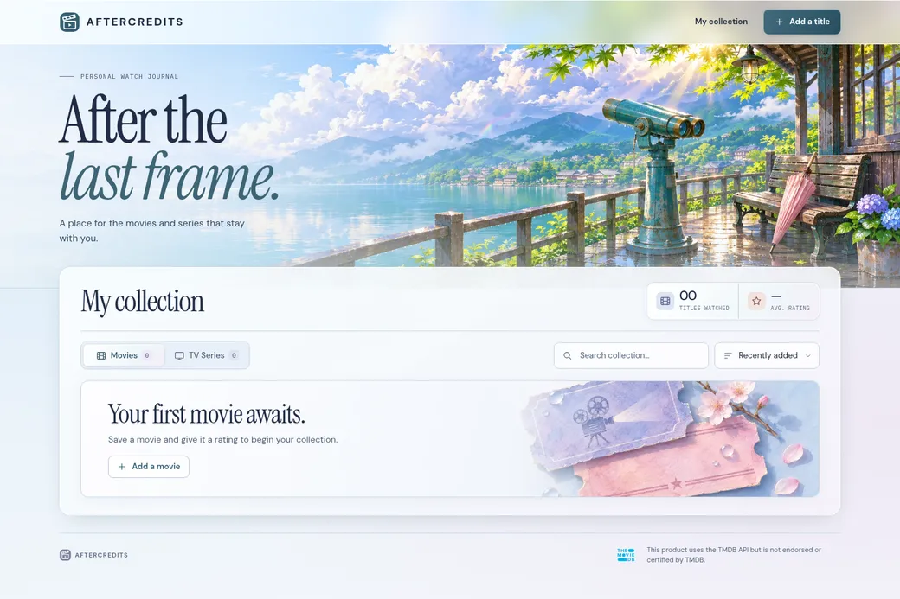
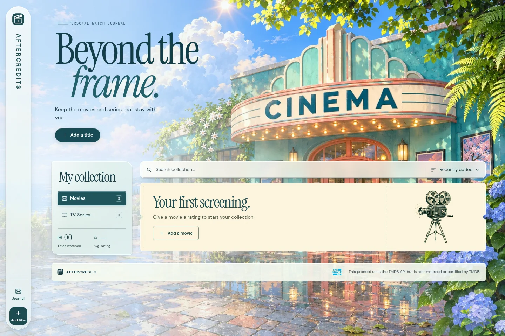
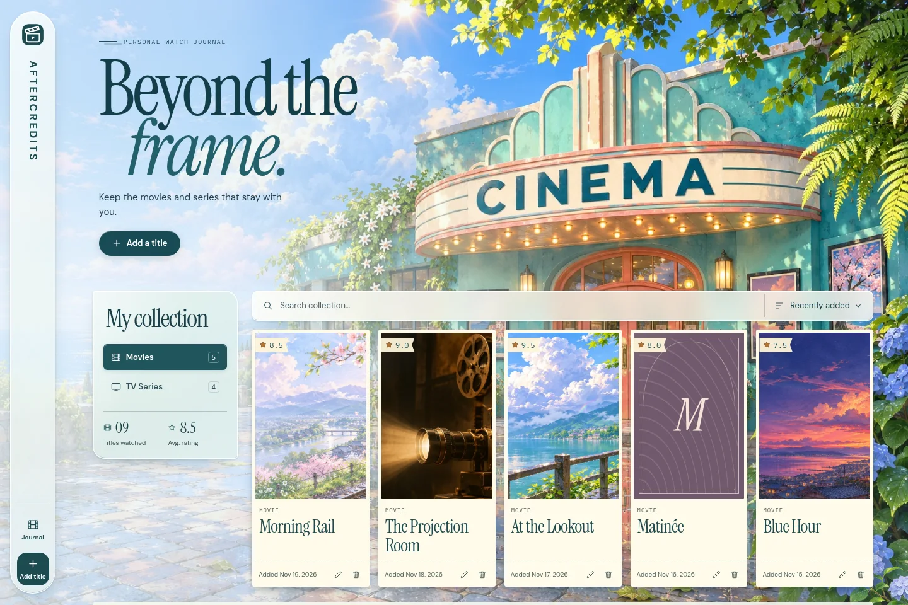
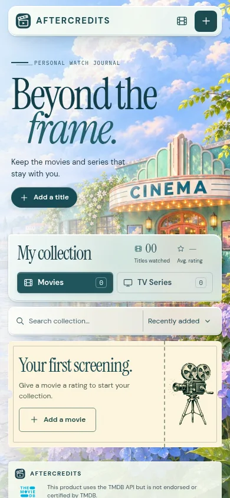
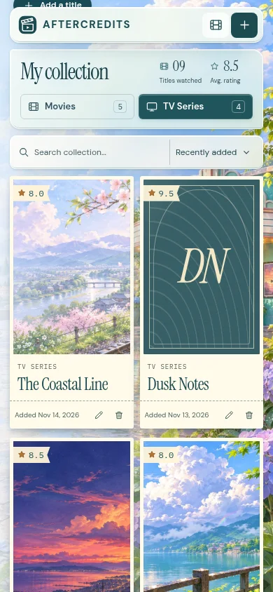

# Beyond the Frame

A coastal cinema after a morning shower is the setting for the whole journal. The marquee sits beside the opening headline, the collection floats above the foyer, and the wet pavement is visible between the poster mounts and beneath the footer. A separate portrait illustration keeps the cinema beside the primary action on a phone.

## Desktop

The previous composition ended the illustration at the collection panel. The new layout keeps the street in view as the gallery scrolls. The fixed glass rail holds the home, journal and add controls. A sticky index keeps Movies, TV Series and collection statistics accessible on a long page.

The populated captures use invented titles in a disposable browser profile. The image requests were intercepted with original AFTERCREDITS scene studies to exercise the poster layout. The production application continues to load catalog artwork from TMDB. The review data exists only in these screenshots.

## Mobile

On narrow screens the rail becomes a floating header, the statistics sit beside the collection heading, and the section buttons sit above the search field. The gallery uses two columns at phone widths. A typographic cover uses the title’s initials when a poster is missing. Both captures are 390 × 844 CSS pixels.

| First visit | Saved TV series, scrolled to the journal |
| --- | --- |
|  |  |

## Rendering and motion

- The browser selects one WebP street illustration for its viewport. Mist, rain glints and a separate foreground hydrangea layer settle after the opening. All decorative layers ignore pointer input.
- The navigation, index and toolbar use the same glass edge treatment and different surface tints. Browsers without backdrop blur use a solid tinted base. The paper gallery mounts reserve a 2:3 image area and keep dates and actions visible.
- The existing GSAP timeline brings the street, headline, primary action and index into view. Card transitions animate movement and opacity. Reduced-motion mode renders the settled scene immediately.

## Verification

| Check | Result |
| --- | --- |
| Storage and Worker contract suite | All seven tests passed with Node. |
| Saved archives | Chromium preserved the exact v2 storage bytes during browsing, sorting, opening details and cancelling edits. Verified legacy migration, cross-tab updates and persistence after closing and relaunching the browser. |
| Collection flow | Exercised manual and catalog entry, half-point ratings, edits, cancelled and confirmed deletion, duplicate detection, search, all four sort controls and both collections. |
| Artwork and network states | Exercised the real Worker module against a local test upstream. Verified exact-title selection, poster and backdrop URL sizes, slow images, failed artwork, rate limits, stale responses, partial details and offline browsing. |
| Responsive behavior | Inspected 1440 × 960 and 390 × 844 captures. Checked overflow at six widths from 320 to 1440 pixels. Exercised collections of 0, 1, 5, 50 and 300 entries on desktop and phone, including opening a title at the end of a long gallery. |
| Accessibility | Verified dialog focus and return, Escape, rating keyboard controls and reduced motion. Axe reported no violations in the tested collection, editor, confirmation and detail views. |
| Production connectivity | Requests to the configured Worker and the TMDB image CDN returned HTTP 403 from this cloud environment. Live search and official image delivery could not be independently verified here. |

The presentation changes require no storage migration, Worker deployment, new service or build step. Browser checks used Chromium 156. Mobile Safari and Firefox were outside the verified browser coverage.
