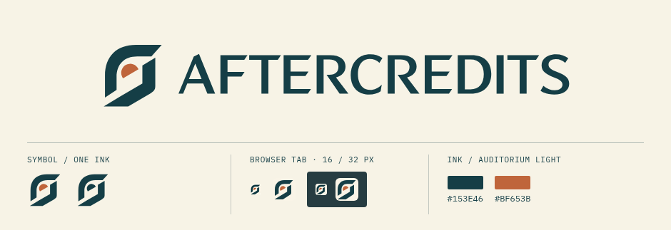
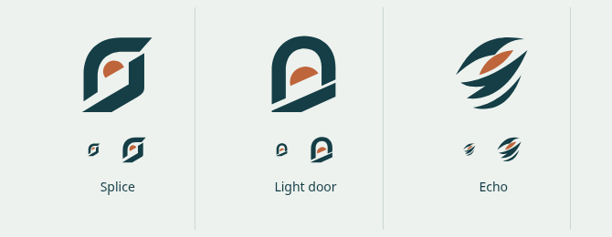
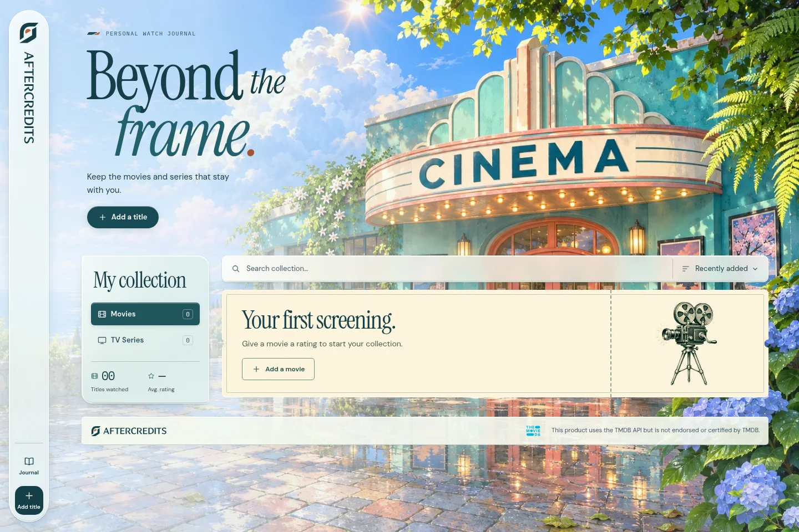
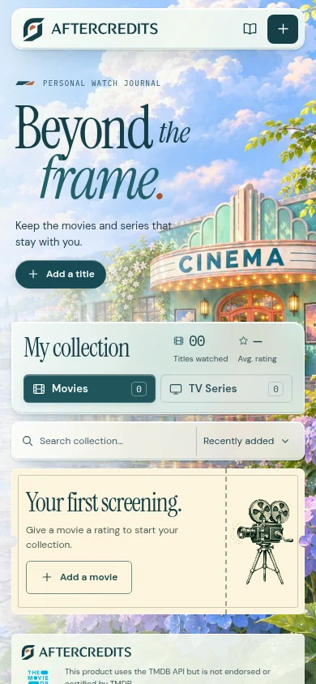
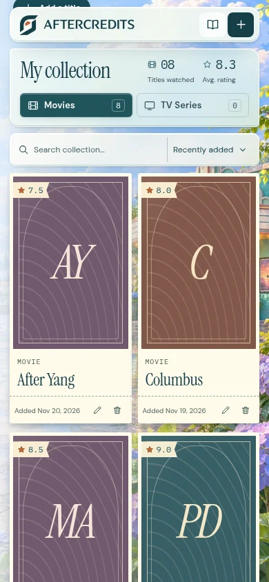

# Splice · The AFTERCREDITS identity

Two cut ends of a cinema frame leave a diagonal opening. A half-sun sits in that gap, like the last illuminated frame after a screening. The open center lets the glass and the street show through.

## Choosing the symbol

I drew three silhouettes and compared them on the journal’s glass rail and at 16 and 32 pixels. **Splice** kept its upper hook, lower rail and sliver of light at all three sizes. **Light door** had a recognizable arch, though the base and arch nearly joined at 16 pixels. **Echo** suggested motion at display size, but its lower strokes ran together at tab size.

## Using the artwork

| Use | Master artwork |
| --- | --- |
| Horizontal lockup and footer | [AFTERCREDITS SVG](../../assets/brand/aftercredits.svg) |
| Standalone symbol | [Two inks](../../assets/brand/splice.svg) · [One ink](../../assets/brand/splice-mono.svg) |
| Wordmark or monochrome horizontal lockup on the web | Append `#wordmark-only` or `#one-ink` to the master SVG image URL. Both are native SVG views. |
| Browser tabs | [16-unit optical drawing](../../assets/brand/splice-tab-v1.svg) · [32-pixel PNG fallback](../../assets/brand/splice-tab-v1-32.png) |

The wordmark uses original outlines. The diagonal ends of **F**, **T** and **E** share the cut of the symbol. The **R** opens below its bowl. The spacing is fitted by letter pair, especially around **FT**, **RC** and **TS**. The lettering renders independently of installed fonts.

Use ink teal `#153E46` for the frame and letters, and copper `#BF653B` for the light. Leave about one frame-stroke of clear space around the symbol. Keep the half-sun and diagonal gap clear of other artwork. For a single-color reproduction, the two shapes and sun print in the same ink. The tab drawing widens the openings and adds a warm paper ground for light and dark browser chrome. Its versioned filename gives browsers a fresh cache key.

The desktop rail keeps the symbol upright and turns the lettering through 90 degrees. The phone header uses a shorter horizontal lockup. A shallow landscape window uses the symbol alone to keep both rail actions reachable. The header’s SVG uses the named paths in the master, so both orientations use the same lettering.

## Typography and motion

| Role | Treatment |
| --- | --- |
| Opening headline | Instrument Serif. The smaller italic “the” lifts above the baseline. The indented “frame” ends in a copper stop. |
| Collection, title cards and dialogs | Upright Instrument Serif, with closer spacing for headings and more leading for wrapped titles. |
| Navigation and descriptions | DM Sans. Medium and semibold weights distinguish actions. Supporting text keeps a regular weight. |
| Ratings, statistics and metadata | IBM Plex Mono. Fixed-width figures keep half-point scores stable. Metadata uses modest tracking and a smaller size. |

The three interface families are self-hosted under their bundled SIL Open Font Licenses. [Instrument Serif](../../assets/fonts/LICENSE-instrument-serif.txt) · [DM Sans](../../assets/fonts/LICENSE-dm-sans.txt) · [IBM Plex Mono](../../assets/fonts/LICENSE-ibm-plex-mono.txt)

The frame edges settle from opposite directions, the sun moves along the opening, and the letters reveal along their reading axis. The introduction finishes in 760 milliseconds. It runs once on load, with a static footer and immediate access to navigation. Reduced-motion mode shows the finished lockup from the first paint. [View the header animation](introduction.webp)

## In the journal

| Opening on a phone | Collection on a phone |
| --- | --- |
|  |  |

These are Chromium captures at 1440 × 960 and 390 × 844. The collection capture uses manually saved example titles in an isolated browser profile.

## Verification

- Inspected the header and footer against the illustrated scene and the header over a scrolled collection. Sampled solid wordmark strokes against the rendered glass at approximately 9.8:1 contrast or higher in these views.
- Confirmed Chromium stored both a 16 × 16 and a 32 × 32 bitmap from the versioned SVG in its favicon database. The specimen shows those browser-generated bitmaps at native size.
- Checked seven viewport sizes, including a 320-pixel phone and an 844 × 390 landscape window. Tested keyboard access to the brand link and switching reduced motion on during the introduction.
- All seven repository tests passed. Browser regression checks covered Movie and TV Series CRUD, search and sort, half-point ratings, saved data after browser restart, keyboard focus, and catalog search and artwork through an isolated Worker upstream. Axe reported no violations in the tested collection and dialog views.
- Browser verification used Chromium. Live TMDB responses, Safari and Firefox were outside this phase’s checks.
