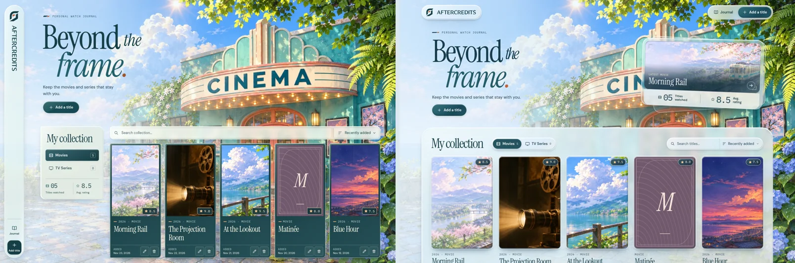
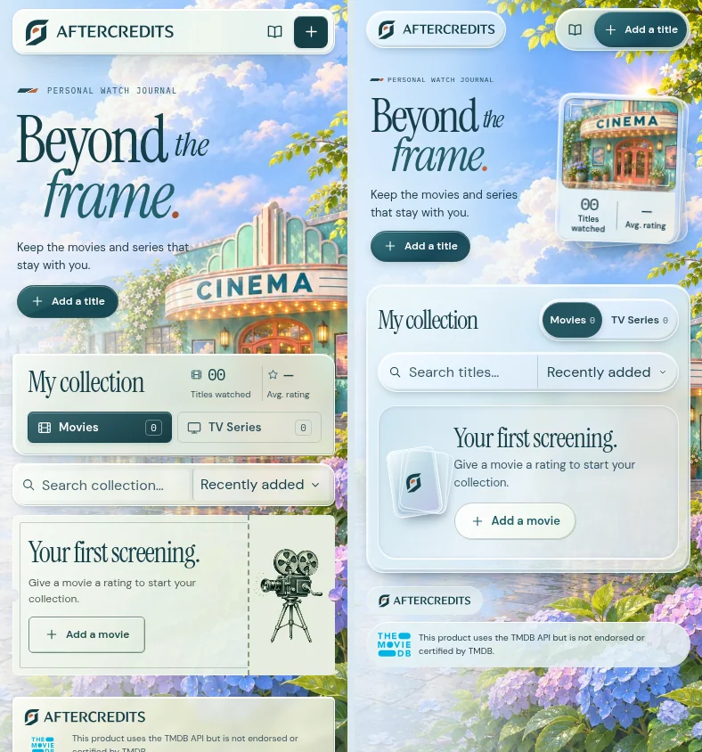

# Phase 2C.1 · Spatial liquid glass

The street now runs between two floating navigation controls and behind a glass viewfinder. On an empty desktop journal, the viewfinder magnifies the part of the cinema façade directly behind it. A phone uses a closer composition of the marquee. Once the active section has a saved title, the same window opens its latest entry. Switching sections changes the featured title. Searching or sorting the shelf keeps the viewfinder in place.

## Before and after

The left image in each comparison shows Phase 2C at `2f1d22e`. The right shows Phase 2C.1. Both were captured from the running application in Chromium using the same viewport and journal. The populated captures use isolated review records and original AFTERCREDITS illustration studies in the artwork slots. No review records ship in the journal.

| Screen at native size | Desktop · 1440 × 960 | Phone · 390 × 844 |
| --- | --- | --- |
| First visit | [Opening and empty shelf](desktop-empty.webp) | [Opening and empty shelf](phone-empty.webp) |
| Populated journal | [Poster shelf](desktop-gallery.webp) | [Poster shelf](phone-gallery.webp) |
| Saved title | [Viewing pane](desktop-detail.webp) | [Detail sheet](phone-detail.webp) |
| Add a title | [Catalog results](desktop-picker.webp) | [Catalog results](phone-picker.webp) |
| Selected title | [Preview and rating](desktop-picked.webp) | [Preview and rating](phone-picked.webp) |

## How the surfaces work

- **Street and viewfinder.** The viewfinder combines offset transparent edges, a sharp aperture and a separate statistics ledge. The desktop lens uses the position and scale of the rendered street image to calculate a 1.18× crop. Scroll updates run at most once per animation frame while the empty lens is visible. Reduced motion disables scroll-driven projection. [Viewfinder implementation](../../js/viewfinder.js)
- **Collection shelf.** The shelf has a sky-tinted backing with a blurred upper edge limited to 420 pixels in height. Each 2:3 poster has a narrow optical rim, a corner score and a separate caption. Edit and delete stay visible. A collection of hundreds of posters uses the same bounded blur surface as a single entry. [Street materials](../../css/street.css) · [Poster mounts](../../css/exhibition.css)
- **Title details.** The saved backdrop fills the upper stage behind the poster and title. The lower pane holds the description, available facts, personal rating and date added. A title without a backdrop opens on a compact tinted stage. Failed images leave the cached text readable.
- **Catalog and rating.** Search results use portrait artwork with the title and year underneath. Selecting a match replaces the query with a poster-and-backdrop preview. “Change selection” returns focus to the original query. The gauge shows the exact value set by its keyboard-accessible slider and half-point buttons. [Picker and detail styles](../../css/dialogs.css)
- **Motion and fallbacks.** Posters lift briefly under a pointer. Each dialog expands from the direction of its opener. Reduced motion presents the completed states, and solid surfaces support reduced transparency, slow-update displays and browsers without backdrop filtering.

## Verification

All seven repository tests passed. The Chromium picker regression covered catalog retry, changing a selection, manual TV entry, half-point persistence, keyboard access to the latest title, and returning the viewfinder to its empty state after deletion.

Browser checks covered movie and series CRUD, duplicate and remake handling, all four sort controls, collection search, cross-tab updates and a full browser restart. Isolated journals ranged from zero to 300 entries. Viewing details, searching and cancelling edits preserved the seeded archive byte for byte.

At widths from 320 to 1440 pixels, checks exercised long multilingual titles, scrolling descriptions, touch and keyboard input, missing artwork, delayed backdrop loading, reduced motion and reduced transparency. Axe reported zero violations in the tested gallery, editor, confirmation and detail views.

Catalog integration ran through the existing Worker module with an isolated upstream. The cloud connection returned a tunnel-level 403 for the deployed Worker and the TMDB image CDN, so a fresh live search and official poster download could not be verified here. Browser verification used Chromium, including emulated tablet and phone layouts.
