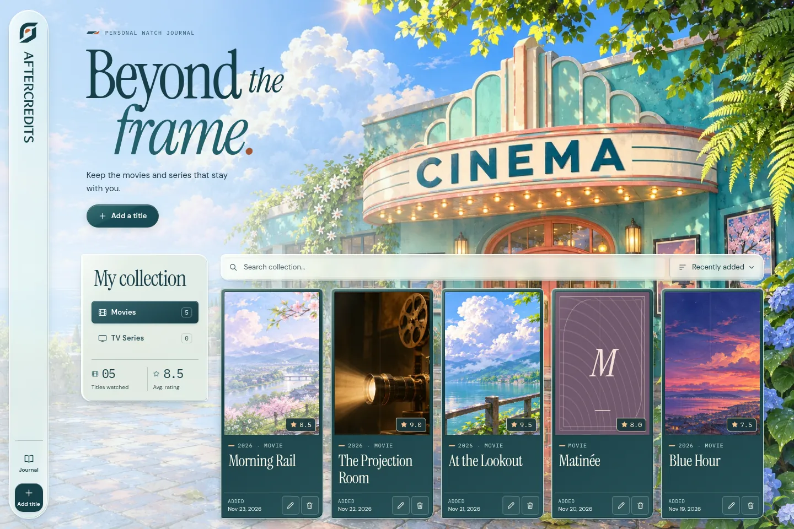

# Phase 2C · The glass exhibition

The journal uses the cinema street’s daylight in two different ways. Sky and foliage show through the navigation rail and collection controls. Around each poster, a smoked teal frame gives the title, personal score and actions a steady contrast as the street moves behind them.

## Compare the screens

These are captures of the running application in Chromium at 1440 × 960 and 390 × 844. Each pair uses the same viewport, entries, ratings, query and scroll destination. The baseline is commit `098a4af`. For repeatable comparisons, the review profiles used test catalog records and original AFTERCREDITS illustrations in the image slots. Live TMDB artwork and results could not be captured from this environment. The fixtures exist only in the review profiles.

| Screen | Desktop | Phone |
| --- | --- | --- |
| Collection | [Before](before/desktop-gallery.webp) · [After](after/desktop-gallery.webp) | [Before](before/phone-gallery.webp) · [After](after/phone-gallery.webp) |
| Title detail | [Before](before/desktop-detail.webp) · [After](after/desktop-detail.webp) | [Before](before/phone-detail.webp) · [After](after/phone-detail.webp) |
| Catalog results | [Before](before/desktop-picker.webp) · [After](after/desktop-picker.webp) | [Before](before/phone-picker.webp) · [After](after/phone-picker.webp) |
| Selected title and rating | [Before](before/desktop-picked.webp) · [After](after/desktop-picked.webp) | [Before](before/phone-picked.webp) · [After](after/phone-picked.webp) |
| Empty journal | [Before](before/desktop-empty.webp) · [After](after/desktop-empty.webp) | [Before](before/phone-empty.webp) · [After](after/phone-empty.webp) |

## Design decisions

- **Glass surfaces.** The navigation rail has the clearest reflection. The collection index has a denser tint behind its numbers. Floating search and sort controls use a shallower blur. Dialogs use one frosted outer surface around the text and controls. Each variant has an opaque base for browsers without backdrop filters. Slow-update displays and reduced-transparency mode use that base directly. [Material definitions](../../css/street.css)
- **Poster mounts.** A narrow bevel and a moving edge reflection frame the 2:3 artwork. The score sits on an inked tab in the lower corner. The year, media type and serif title occupy a separate caption. Dates and visible edit and delete buttons align along the foot of each row. Gallery images load lazily and use density-aware sources. The browser applies no backdrop filters to individual cards. Missing or unreachable posters reveal a title-initial plate. [Gallery styles](../../css/exhibition.css)
- **Title details.** The desktop view opens with a panoramic backdrop, then pairs a separately mounted poster and personal rating with the title, description and available facts. The phone sheet keeps its close control reachable while the text scrolls. A backdrop with a valid path has reserved space while it loads. A saved title without a backdrop starts directly with its details.
- **Catalog and rating.** On desktop, search and rating sit side by side above a full-width grid of matching titles. On a phone, results follow the search input, putting the next choice within reach. Selecting a result places its poster, title and year beside the rating, with a way to change the selection. The meter pairs an exact numeric readout with a native range input and half-point keys. Its end stops disable the corresponding key. Manual entries use the same meter. [Dialog and control styles](../../css/dialogs.css)
- **Feedback.** Illuminated edges identify focus, a pressed surface confirms activation and a brief reflection follows pointer hover. Catalog errors expose retry and manual entry. Escape dismisses a sheet and focus returns to its opener or the next available card after deletion. Reduced motion presents the settled states immediately.

## Verification

| Area | Result |
| --- | --- |
| Repository checks | All seven Node storage and Worker contract tests passed. The committed picker regression also passed in Chromium, including rate-limit recovery, keyboard media selection, selecting and clearing a match, and saving a half-point rating. |
| Collection | Tested empty, one, five, nine, fifty and three hundred entries in temporary browser profiles. Checked both media sections, create, edit, cancel, confirmed deletion, duplicates, search, all four sort controls, totals and average. |
| Persistence | Checked legacy migration, saved ratings after reload and browser restart, cross-tab updates, and blocked storage. Browsing and cancelling left the seeded archive byte-for-byte intact. |
| Catalog and images | Ran the production Worker module locally with an isolated upstream fixture. Checked exact selection, same-ID movie and series, slow and superseded requests, empty results, throttling, retry, offline search, partial details and cached metadata. Checked image sizing at normal and 2× density, broken posters and backdrops, and delayed backdrop loading without a title shift. |
| Input and layout | Tested keyboard focus and restoration, touch input, slider minimum and maximum, half-point changes, long multilingual titles and scrolling descriptions. Checked viewport widths from 320 to 1440 pixels, including a 768-pixel tablet. |
| Accessibility | Axe reported zero violations in the tested gallery, editor, confirmation and detail views. Tested switching reduced motion on during a transition and verified the solid rail in reduced-transparency mode. |

The cloud network blocked connections to the deployed Worker and the TMDB image CDN. A fresh live search and download of an official poster remain unverified in this environment. Browser checks used Chromium, including emulated touch layouts. Safari, Firefox, physical devices and screen readers were outside these checks.
