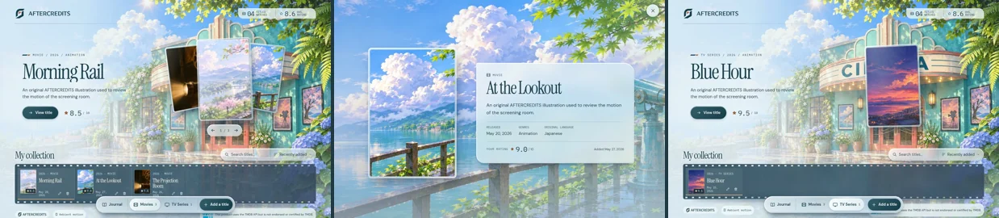
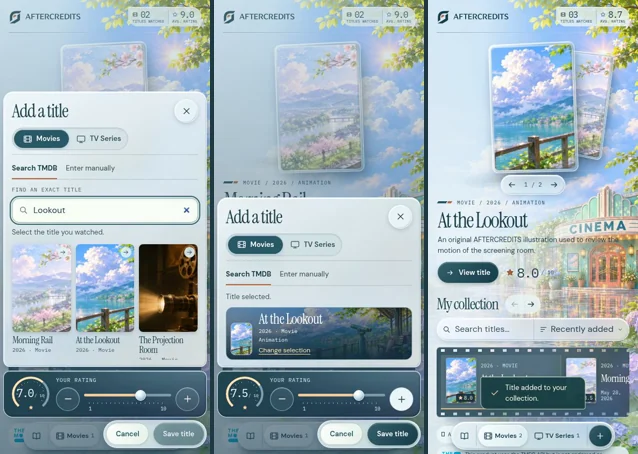

# Motion in the screening room

A side poster comes forward from its existing angle while the previous title recedes. The editorial heading follows the print, and the filmstrip keeps the selection in view. Open the title and the print travels from the point of activation into its reading pane. On a phone, dragging the stage moves the posters under your finger. Releasing below the swipe threshold lets them settle back.

[Watch the desktop opening, poster travel, detail projection and section change](screening-room.mp4) · [Watch the phone catalog search, poster selection, rating and save](phone-picker.mp4)





Both recordings come from Chromium. The titles and artwork in these captures are isolated review fixtures using original AFTERCREDITS illustrations. The production client continues to use the saved TMDB paths.

## Timing and materials

| Interaction | Behavior |
| --- | --- |
| Opening | Splice leads a single exposure of the street, stats, dock, stage, and archive. The first sequence settles in about 0.6 seconds. A repeat visit in the same tab skips the camera move and shortens the remaining cues. Controls are live throughout. |
| Atmosphere | Three intermittent rain streaks, a local moving bank of mist and a slight movement in the foreground flowers give the street depth. Phone layouts use fewer layers. **Ambient motion** in the footer pauses the environment and remembers the choice on this browser. Hidden documents and open dialogs pause the decorative layers. |
| Browsing | The stage samples the live position of each mounted print before starting the next move. Repeated inputs redirect the current movement. The dock lens, stage captions and visible strip frames move on the same timing scale. Search, sort and editing share stable entry IDs. |
| Projection | The actual stage or filmstrip poster supplies the opening bounds. The backdrop develops independently as its image arrives. The glass, title, personal rating and notes follow. Closing during the opening starts from the displayed pose. A resize settles the pane into its new layout. An unavailable origin uses a short local return. |
| Catalog | The catalog surface opens toward the initiating control. A search response introduces up to six prints. Choosing one carries it into the preview while details load. The rating value changes immediately in half steps, with directional movement in the number and a brief highlight at the upper end of the scale. |
| Collection changes | A save writes to storage before the closing animation. The new ID selects the arriving print even under alphabetical or rating sort. Editing accents the changed caption and rating. Confirming deletion lets the departing strip frame lift away while the neighboring frames take their positions. |

The timing scale in `css/site.css` uses 155 ms for a tap, 265 ms for a shift, 435 ms for poster travel and 560 ms for projection. A 27 ms beat sets the stagger. The Web Animations API owns finite visual transitions. CSS handles the bounded environmental layers, small optical highlights and the brand mark. Optional, self-hosted GSAP animates counters after the interface is ready.

Keyboard focus, exact values and storage commits belong to application state. Each animated element has one interruptible effect. Runtime reduced motion, page visibility and resize can settle active effects. A missing GSAP bundle, missing Web Animations API or rejected keyframe leaves controls usable. The atmosphere preference uses its own key, separate from the existing archive.

## Performance measurements

Five paired runs per revision in Chromium 156 on the same cloud machine, at 1152 × 760. The comparison used the merged screening room at `ee7d889` and the Phase 2D build. Each pair alternated which build ran first. Both were served by Python over loopback with native browser caching, the same assets and browser settings. The load metric ends when the collection status is populated. Warm visits reused the same browser context. The sort and navigation samples used the same 300 manual entries, without any remote image requests.

| Median across five runs | Approved release | Phase 2D |
| --- | ---: | ---: |
| Cold empty collection ready | 295.0 ms | 294.0 ms |
| Warm empty collection ready | 48.1 ms | 42.1 ms |
| 300-title sort, including synchronous layout | 240.9 ms | 35.1 ms |
| 95th-percentile animation-frame interval during rapid navigation | 16.7 ms | 16.8 ms |

The largest measured change was in sorting. The filmstrip now reads layout near the visible frames and lets the browser skip offscreen contents. Unchanged records and poster nodes survive unrelated writes. Two of the five Phase 2D navigation runs recorded a 33.3 ms 95th-percentile interval. These browser frame callbacks measure scheduling and cannot establish display presentation at a sustained 60 FPS. The loopback measurements also cannot reproduce the reported corporate Wi-Fi stalls.

## Browser verification

- Ran all seven storage and Worker contract tests. Exercised movie and series catalog CRUD, manual entry, retry, partial metadata, stale responses, missing images, offline use, reload, full browser restart and cross-tab updates.
- Checked empty collections and 1, 5, 9, 50 and 300 entries. Exercised rapid stage and section changes, keyboard focus restoration, real Chromium touch events, saving under an existing sort, and interruptions during projection. Viewport checks ranged from 320 to 1440 pixels wide.
- Checked runtime reduced motion, persistent atmospheric pause and native hidden/visible lifecycle events through navigation and browser Back. Tested the application with GSAP requests blocked and with Web Animations unavailable or rejecting calls.
- Checked slow backdrop decoding, missing artwork and unusually long titles. Automated accessibility scans reported no violations in the four tested states.
- The cloud proxy denied outbound connections to the production Worker and image CDN. The catalog tests used the actual Worker with a controlled upstream. Physical-device Safari, battery consumption and corporate network timing were outside this run.

With Chromium, Python Playwright and a local server running, the checks below use disposable browser contexts. Pass a second served revision to the performance script to reproduce a paired comparison.

```sh
node --test tests/*.test.mjs
python3 tests/picker.browser.py
python3 tests/motion.browser.py http://127.0.0.1:8220/aftercredits/
python3 tests/motion_perf.py http://127.0.0.1:8230/aftercredits/ http://127.0.0.1:8220/aftercredits/
```
