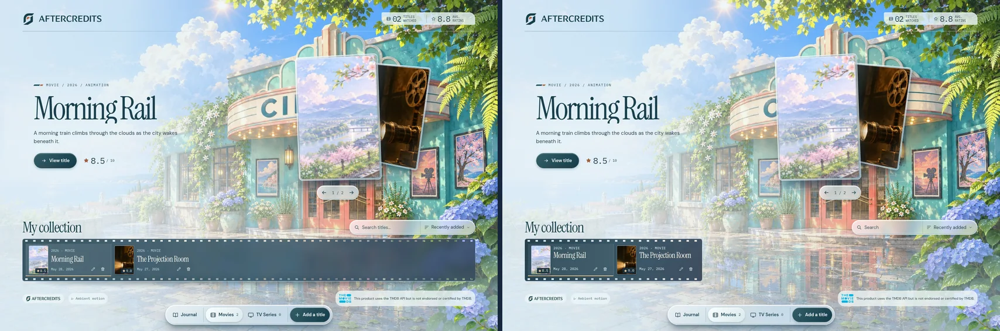
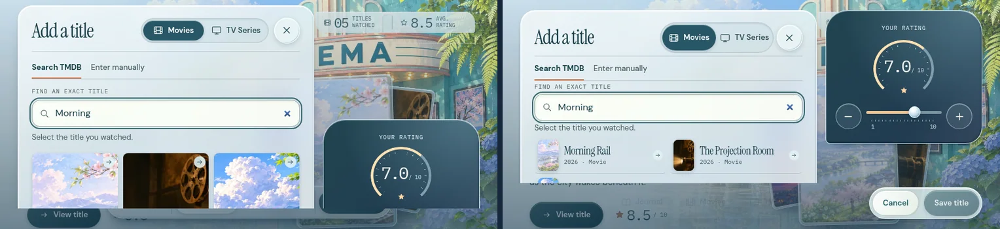

# The screening room at every size

This review compares the approved Phase 2D build at `4ae97ee` with the final screening room. The main changes are visible with two saved titles, a bright reflection behind the filmstrip, or a phone keyboard taking up half the screen.

## The poster stage and filmstrip

With two titles, the active poster used to sit on the centerline, with the second poster to its right and an empty strip stretching across the street. The two prints now share the stage. A single print retains the solo position. Adding a third brings back the full arrangement. The filmstrip fits its contents up to the available width, then scrolls. Empty states and storage notices keep their full reading width.



On the selected frame, the light street behind the glass made the date and media caption difficult to read. The film base now has a deeper blue tint, a softer selected reflection and a single painted shadow. The 10 px metadata lettering and tabular scores stay clear of the touch controls. We sampled the background pixels beneath the lettering with the foreground temporarily hidden. The lowest contrast sampled on this frame rose from **4.24 to 5.63** for the media caption, **4.33 to 5.65** for the date and **5.44 to 6.15** for the title. These measurements cover the captured street and selection.

- On touch screens, the stage arrows grew from 34 × 31 to 44 × 44 CSS pixels. The strip arrows and edit/remove targets also measure 44 × 44. The filmstrip button's accessible name now starts with the visible title, followed by the media caption and rating.
- Closing a projection midway through its entrance used to make the reading pane jump to full opacity and its resting position. Closing now holds the pane and captions at their displayed exposure while the print returns. The opener regains focus.

[Desktop room](desktop-room.webp) · [Tablet room](tablet-room.webp) · [Phone room](phone-room.webp) · [Phone projection](phone-detail.webp) · [Empty phone collection](phone-empty.webp) · [Desktop motion recording](poster-return.mp4)

## A picker that fits above the keyboard

At 320 × 568, catalog results pushed the bottom edge of Save to y = 608. In 844 × 390 landscape it reached y = 485. The footer now stays at y = 552 and y = 368 respectively. Search, results, selection and rating share one scrolling area in short viewports. When height is especially tight, a result puts its thumbnail, title and year on one line. The command row accounts for the available visual viewport and safe-area insets.



[Compare the phone picker with 385 px of available height](short-picker.webp) · [Phone recording of search, selection, rating and save](compact-picker.mp4)

The captures and recordings come from Chromium using isolated profiles. The review titles and poster images are fixtures using original AFTERCREDITS illustrations. They let both revisions show identical content. Live collections use their saved TMDB artwork paths.

## Loading and large collections

An ordinary Phase 2D startup read the archive twice and requested an exclusive Web Lock before displaying it. A second tab holding that lock could leave an otherwise readable collection waiting. Opening the room now reads the current archive once. Legacy migration rechecks the latest archive under the write lock before copying. Edits, saves and deletions still coordinate through that lock.

The three mounted poster images can begin decoding immediately. Filmstrip thumbnails continue to use lazy loading. The optional 73,355-byte GSAP counter bundle loads on a collection-editing action or a subsequent statistics change with motion enabled. Smaller portrait street and glass-film images use the original artwork, with full-density versions available for sharper displays. The typefaces stay self-hosted.

| Median of five paired runs | Phase 2D | Phase 2E |
| --- | ---: | ---: |
| Cold collection ready | 288.5 ms | 253.2 ms |
| Warm collection ready | 52.3 ms | 33.6 ms |
| Sort 300 titles, including layout | 36.2 ms | 32.1 ms |
| Rapid browsing, 95th-percentile frame interval | 16.8 ms | 16.8 ms |

An intermediate build took 53.1 ms to sort 300 titles against a paired 31.9 ms baseline. On browsers that support state-preserving DOM moves, the final implementation reorders existing frames in place, keeping their focus and artwork attached. Older browsers retain the bulk reorder path. The final median was 32.1 ms, with individual sorts between 31.0 and 36.6 ms.

For the timing comparison, the existing Phase 2D harness alternated revisions across five pairs in the same Chromium 156.0.8078.79 process at 1152 × 760. Each pair used fresh contexts and local HTTP. Cold and warm times end at the first populated collection status. Sorting measures a 300-entry reorder and synchronous layout. Navigation samples animation-frame callbacks during repeated poster changes. The original published Phase 2D medians were 292.6, 59.9, 32.4 and 16.8 ms respectively. The fresh paired results above are the direct comparison. [Individual runs](measurements.csv) · [Benchmark source](../../tests/motion_perf.py) · [Phase 2D report](../phase-2d/)

| Empty collection, cold visit | Phase 2D | Phase 2E |
| --- | ---: | ---: |
| Desktop, 1440 px, device pixel ratio 1 | 1,095,514 B | 1,027,945 B |
| Phone, 390 px, device pixel ratio 1 | 856,286 B | 532,803 B |
| Phone, 390 px, device pixel ratio 3 | 856,286 B | 788,717 B |

The resource totals sum the document and resource timing entries’ encoded body bytes on settled, cold, empty visits, including self-hosted fonts and scenery. The dense phone requested the full-density artwork. These figures exclude HTTP headers and describe the local server's responses. In a separate run, browsing, projection and a manual save all completed while the decorative images, catalog images and optional animation library were held pending.

In a 300-title profile, we opened, closed and advanced through 40 projections with reduced motion. After garbage collection, Chromium reported used JavaScript heap of 1.93 to 2.13 MiB for Phase 2D and 1.67 to 1.97 MiB for Phase 2E. Each finished with three mounted prints, zero departing frames and four more document elements than at the start. This spot check covers the JavaScript heap. Decoded image memory and long-session memory growth need separate measurements.

## Verification

| Area | Result in Chromium |
| --- | --- |
| Archive | Contract tests for v1 migration, v2 integrity, duplicate identity and malformed storage passed. Manual and catalog CRUD passed in Movies and TV Series, including half-point scores, the limits of 1 and 10, deleting the last title, reload and full browser restart. Two tabs saw the same saved change. The read-while-locked regression checks the existing stored bytes before releasing the writer. |
| Collection | Exercised empty, 1, 2, 3, 5, 9, 10, 50 and 300 entries across desktop and phone profiles, including search, no matches, sorting, opening the last print, long Unicode titles, long descriptions and absent artwork. |
| Input and layout | Checked 320, 360, 390, 430 and 768 px widths, desktop, phone landscape and a reduced visual viewport. Chromium at actual 200% and 400% browser zoom kept the editor actions within reach. Keyboard activation, visible focus, native dialog containment, return focus and touch swipes passed. |
| Accessibility and motion | axe reported zero violations in the populated room, editor, confirmation and projection scans. Checked accessible names and descriptions, status semantics, reduced transparency, reduced motion during a transition, rapid poster/section changes, repeated dismissal, ambient pause and missing animation APIs. |
| Metadata and network | The checked-in Worker passed its contract tests. The frontend searched and saved both media types through that Worker using a controlled upstream. Slow, stale and failed responses, retry, partial details, missing images and offline collection use were exercised. |

The cloud network refused the connection to the deployed Worker and the TMDB image CDN. Live production results could not be verified here. Browser emulation covered a keyboard-sized viewport and touch input. Physical-device virtual keyboards on iOS and Android, Safari rendering, assistive speech output and device GPU or battery use remain unverified. Loopback timing does not reproduce the reported corporate Wi-Fi stalls.

To repeat the repository checks, serve the repository root at the URL passed to the browser scripts. They open disposable profiles.

```sh
node --test tests/*.test.mjs
python3 tests/picker.browser.py
python3 tests/motion.browser.py http://localhost:8000/
python3 tests/finish.browser.py http://localhost:8000/
```
