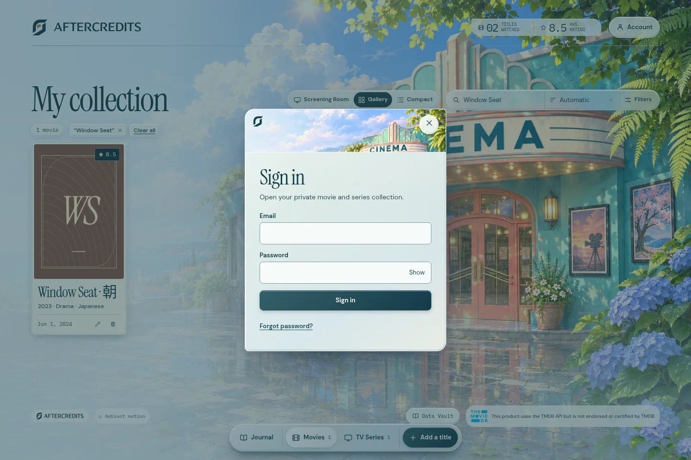

# Private accounts in AFTERCREDITS

Open **Account** beside the collection totals. On phones, use the person icon. Guests can keep using the journal, including Data Vault, without signing in. Signing in opens the private collection immediately. A returning device displays its saved copy while sync runs. A new device shows a first-sync message while it retrieves the account’s titles.

[Account on desktop](account-desktop.webp) · [Account on a phone](account-mobile.webp) · [Opt-in registration on a phone](registration-mobile.webp) · [Guest import review](guest-import.webp) · [Resolving a rating conflict](conflict-desktop.webp)

## How accounts work

| User action | Result |
| --- | --- |
| Sign in | Enter an email and password. A device with an empty guest archive goes straight to the private library with zero downloads or migration steps. |
| Bring in guest titles | Open **Account → Review guest titles**. Review the counts and any differences, then choose **Import guest titles**. Cancel or close to keep browsing. The guest archive stays available after sign-out. |
| Change a display name | Open **Account → Settings**. The name belongs to the Supabase Auth profile. It appears in the account sheet and desktop control. It can change independently of the email and archive owner. |
| Check sync | **Account** shows a short status. **Settings** includes the last successful sync, pending changes when applicable, offline readiness and **Sync now**. When two edits disagree, **Review sync conflicts** opens their existing three-way comparison. |
| Back up or recover titles | **Account → Data & backup** opens the existing Data Vault. Its footer shortcut still works in guest and private archives. |
| Reset a password | Choose **Forgot password?**, request an email code, then enter it with a new password. After a successful reset, sign in again. |
| Switch accounts | Sign out to return to the guest journal, then sign in with the other email. Unsynced changes, backups and browsing preferences stay associated with their owner on the device. |

Self-service registration is **disabled by default**. Administrator-created email/password accounts work in this mode. With verified registration enabled, **Create account** accepts a display name, email and password. An emailed code completes the signup and opens the archive. An unconfirmed sign-in returns to verification, with an option to request another code.

## Architecture and data boundaries

- The account sheet loads on demand. Its native dialog uses the journal’s glass materials, scene, reduced-motion behavior and focus restoration. Password visibility is an accessible per-field control. Form submission reports progress, validation and errors. [Account sheet](../../js/cloud/panel.js) · [Auth screens](../../js/cloud/account-forms.js)
- Supabase Auth issues and verifies credentials through its password grant, signup, verification, resend, recovery, user-update and session APIs. First connection takes the auth and archive locks, initializes a missing owner cache, and publishes the session only after the cache write succeeds. An existing cache, including an outstanding operation, is reused. An unfinished Phase 3B connection resumes without transferring guest titles. Passwords and email codes stay in the form/request lifecycle. [Auth client](../../js/cloud/auth.js)
- Archive access uses the authenticated UUID and the established project/owner namespace. Editable display names come from user metadata and are rendered as text. Database authorization still derives the owner from the verified JWT and `auth.uid()`. This release requires **no SQL migration**. The primary guest key, account cache format, recovery histories, RLS policies and RPC contracts are unchanged.
- Guest import is opt-in and merge-only. It validates the guest source, compares it with the synced private archive, excludes previously deleted cloud IDs and keeps the account’s version of a conflict by default. Import checks the remote revision, then checks the source bytes and local state under locks. A stale preview must be reviewed again. Data Vault saves an account recovery snapshot before a changed merge and sends the edit through the existing durable queue. A concurrent cloud write still goes through the existing reconciliation rules. [Guest import](../../js/cloud/guest-import.js) · [Vault persistence](../../js/vault-store.js)
- The account sheet reveals troubleshooting actions when relevant. Sign-out removes the local session, hides private content and attempts to revoke that session with Supabase. Offline sign-out cannot confirm server revocation. Clearing browser data can erase an unsent edit. A shared browser profile can read its same-origin device storage outside the app. Use separate browser profiles on shared devices when that distinction matters. [Storage and sync architecture](../phase-3b/)
- The offline shell release is `4a.1-accounts.1`. It caches the account modules and styling. The worker also tracks the public registration and CAPTCHA options across upgrades. Auth replies, email codes, CAPTCHA scripts and private collection records stay outside the shell cache. Close older app tabs and reopen online to adopt a new release.

## Manual Supabase setup

### Invite a small group with registration closed

1. Use the existing Supabase project. Under **Authentication → Sign In / Providers**, enable **Email**, keep **Allow new users to sign up** off and keep **Confirm email** on. Leave anonymous sign-ins disabled. The shipped frontend setting is `allowRegistration = false`. The server setting enforces who may register through the public Auth API. [Public UI options](../../js/account-config.js)
2. Under **Authentication → URL Configuration**, set the Site URL to the actual HTTPS GitHub Pages address, including the repository path and trailing slash. For this repository it is `https://lord80.github.io/aftercredits/`. Use the exact deployment URL for any allowed redirects. The screens in this release use codes entered in the app.
3. Under **Authentication → Users → Add user → Create new user**, create the friend’s account with a strong random password. Use **Auto Confirm User** only after independently confirming the intended address. With recovery mail configured, the friend can use **Forgot password?** to choose their own password directly. The email template setup below applies to administrator-created accounts as well.
4. Keep the existing project URL and publishable key. New installations can follow the Phase 3B database setup. Database passwords, SMTP credentials, service-role keys and CAPTCHA secrets belong in their respective dashboards. [Existing deployment guide](../phase-3b/)

### Configure verification and recovery mail

1. Configure a sending domain with your SMTP provider, including its SPF and DKIM records. Under **Authentication → SMTP Settings**, enable custom SMTP and enter the sender name, verified sender address, host, port, username and password. Use the TLS settings specified by the provider. The built-in Supabase sender has recipient and volume restrictions.
2. In **Authentication → Email Templates**, paste the supplied HTML into **Confirm signup** and **Reset password**. Suggested subjects are “Confirm your AFTERCREDITS account” and “Reset your AFTERCREDITS password”. Both templates use Supabase’s single-use `{{ .Token }}`. The browser accepts 6–10 digit codes. [Confirmation template](email/confirmation.html) · [Recovery template](email/recovery.html)
3. Under **Authentication → Rate Limits**, review the project-wide sending quota and the limits on sign-in and verification requests. For a small pilot, a starting budget is 30 auth emails per hour if the provider permits it, with at least 60 seconds between repeat emails to the same address. Set a short email OTP lifetime, such as 15 minutes, under the Email provider settings. These are proposed rollout settings. The app respects server rejection and rate-limit responses. Keep sufficient email capacity for password resets. [Supabase rate limits](https://supabase.com/docs/guides/auth/rate-limits) · [Custom SMTP](https://supabase.com/docs/guides/auth/auth-smtp)
4. Use a disposable staging account and a mailbox outside the project team to verify delivery, expiry, resend and password reset before inviting friends. The test suite exercises the actual template HTML through a local SMTP mailbox. Live deliverability depends on the sender domain and provider.

### Later rollout of self-service registration

1. In staging, configure **Confirm email**, SMTP and the confirmation template first. Set a server password policy appropriate to your group. The form requires at least eight characters for new passwords, and the server enforces its configured policy.
2. If using Cloudflare Turnstile, create a widget for the app hostname. Put only its **public site key** in `turnstileSiteKey`. Under Supabase Auth’s **Bot and Abuse Protection**, select Turnstile and store the **secret key** there. Coordinate both changes in the same release. The widget loads on auth forms only when configured. Missing or failed verification keeps submission from proceeding. The integration passes the response to Supabase for server verification. [Supabase CAPTCHA guide](https://supabase.com/docs/guides/auth/auth-captcha)
3. When ready for public signup, enable **Allow new users to sign up** in the intended project and publish `allowRegistration = true` through the normal Pages deployment. Check registration, emailed confirmation, sign-in and recovery in a fresh browser. To close registration again, turn off the Supabase signup setting first, then republish the app with the flag off. Existing users can still sign in.

## Verification

All automated tests use disposable records and browser profiles. The cloud suites start real Supabase Auth 2.177.0, PostgREST 12.2.3, PostgreSQL 17 and Mailpit. The confirmation and recovery messages were rendered by Auth from the two HTML files in this directory.

| Check | Coverage |
| --- | --- |
| Core regression | 32 Node tests cover collection storage, cloud reconciliation, discovery, the TMDB Worker contract, backups and recovery. |
| Sign-in and signup | Administrator-created users with registration closed, rejection by the disabled server, optional verified signup, failed credentials, password visibility, validation, incorrect and valid confirmation codes, recovery by SMTP code and display-name updates. |
| Private reopening | Empty first login without a download or preview, populated guest login without uploading, storage failure, cached reopening with cloud reads unavailable, subsequent queue upload, and an unfinished earlier connection. |
| Consent and ownership | Cancellation, manual conflict selection, preservation of guest bytes, previously deleted titles, stale guest previews, recovery snapshots, queued work across sign-out, account switching, expiring sessions across tabs and per-owner discovery preferences. Database checks exercised isolated RLS ownership and denied anonymous access and direct client writes. |
| Sync and offline shell | Two-device edits, interrupted acknowledgements, pagination, conflicts and Vault import/restore/recovery. Chromium upgraded a Phase 4A and a Phase 3B shell on the same repository subpath, reopened a private collection offline and queued a rating edit. |
| Interface | Real Chromium desktop and mobile captures, form fit from 320 to 1440 CSS pixels, keyboard focus restoration, password visibility and reduced motion. Automated axe-core WCAG A/AA checks covered the signup sheet and connected account menu. The existing picker, motion, finish, Vault and discovery browser suites also ran. |
| Optional CAPTCHA | A controlled widget exercised script failure and delivery of its response in the Supabase auth request. End-to-end verification with a live Turnstile secret is a rollout check. |

Run `node --test tests/*.test.mjs`, then `python3 tests/cloud.browser.py` and `python3 tests/accounts.browser.py` with Docker, Python Playwright and Chromium. An optional output directory writes captures. Set `AXE_JS` to a local axe-core script to include the accessibility checks. The discovery upgrade suite accepts a separate checkout of the previous release. [Other browser regression commands](../phase-4a/#reproduce-the-checks)

Testing used local services and Chromium touch emulation. Production Supabase, live TMDB, public SMTP delivery, a live Turnstile account, physical devices and other browser engines were outside this verification. A new device needs an online sign-in and first download. A previously connected device can reopen its cached library while offline.
