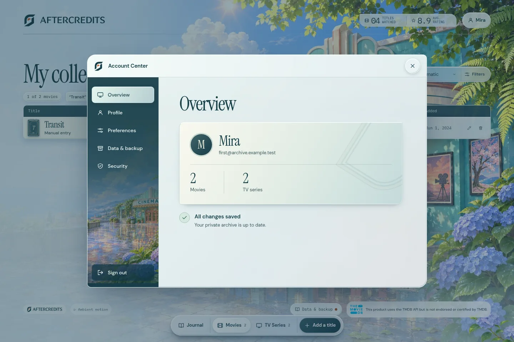

# Account Center and automatic saving

Open **Account** beside the collection totals. Signing in opens the private archive immediately. A returning user sees their saved device copy while the journal checks for changes. The footer’s **Data & backup** shortcut opens the backup section of the same window. Guests can use it directly, or choose **Guest settings** from sign-in.



## Using the center

| Section | What you can do |
| --- | --- |
| Overview | See whose archive is open, movie and series totals across all filters, and the current save status. A failed request or conflicting title brings its own action here. |
| Profile | See the account email and initials, change the display name, or sign in from a guest journal. |
| Preferences | Set the collection layout, individual movie and series sort orders, and ambient motion. The collection and settings share the same preference handlers. Discovery preferences belong to the current archive on this device. Ambient motion remains a device preference and respects system motion settings. |
| Data & backup | Download a full JSON backup, preview an import, or review guest titles when present. Advanced options include CSV, the last generated backup date, device storage and recovery history. |
| Security | Request a password recovery code for the account email. On a phone you can also sign out here. Desktop has a persistent sign-out action in the navigation rail. Pending edits remain in the owner’s device cache for their next sign-in. |

The desktop window keeps navigation in view while the section scrolls. At phone widths the window fills the viewport and uses an icon-and-text section bar. Escape returns focus to the control that opened the center. Only a change of account identity reloads the journal during normal use.

[Mobile overview](captures/account-mobile.webp) · [Mobile preferences](captures/preferences-mobile.webp) · [Desktop sign-in](captures/signin-desktop.webp) · [Mobile registration on the opt-in test deployment](captures/registration-mobile.webp)

## Backup, guest transfer and recovery

A JSON download includes existing IDs, titles, dates, ratings, metadata and artwork paths. Store the resulting file somewhere you control. The export date records file generation. Artwork files require their original source. CSV is available for spreadsheet use under **Advanced options**.

An import previews new titles, duplicates, differences and invalid entries. The default keeps current records. Choosing an incoming version requires a decision for that title. The optional **Replacement options** disclosure contains full restoration. Replacement requires a fresh download of the current archive, explicit consent and a final confirmation. Closing a preview, leaving its section or closing the center cancels work still waiting for a storage lock.

Guest transfer uses the same review inside the account. Opening an account leaves guest records on the device. Transfer checks the guest source, server revision and existing tombstones before applying authorized choices. Recovery history remains local and bounded. Clearing browser data can remove pending edits and all local recovery copies. [Backup tools](captures/backup-desktop.webp) · [Guest transfer preview](captures/guest-import.webp) · [Backup format and recovery rules](../phase-3a/)

## When changes save

1. An edit first goes through the existing durable, owner-scoped collection writer. A short debounce lets a burst of edits share a sync cycle.
2. A signed-in, visible journal checks on startup, after sign-in, after an edit, on reconnection and on return to the tab. An open foreground tab also checks about once per minute. A recent successful check suppresses redundant focus and periodic requests across tabs.
3. A per-account Web Lock coordinates network cycles. The archive lock protects short local updates. Pulls use the existing pinned, paginated RPC. Independent edits merge automatically, including changes to different fields on a single stable title. Incompatible ratings, identity changes and edit-versus-delete disagreements can require a title-level choice. The comparison includes each full saved version. [Conflict review](captures/conflict-desktop.webp)
4. Leaving the foreground, going offline or signing out cancels outstanding sync requests. A lost acknowledgement leaves the operation ID and payload available for safe replay. Individual requests have a 12-second timeout. Transient failures retry after 2, 4, 8, 16 and 32 seconds. After that the journal waits for a new lifecycle event, an edit or a contextual retry. A conflicting archive waits for a decision.
5. **Saved on this device** describes guest storage. **Saving changes** covers private edits awaiting acknowledgement. **All changes saved** requires a successful sync and an empty queue with no operation in flight. Offline and error states identify the device copy. Unsupported or blocked local storage has its own warning. Automatic synchronization resumes in an open, connected journal.

## Implementation and release

- The native dialog and its rail live in `index.html`. `js/cloud/panel.js` handles section navigation, focus, state and authentication. Title comparisons load from `js/cloud/conflict-view.js` when needed.
- `js/vault.js` mounts backup tools in the Data & backup section. The existing validators, file formats, checkpoint store, archive keys and mutation locks are shared with the previous release.
- `js/cloud/sync.js` owns foreground scheduling, retries and cancellation. `js/cloud/cache.js` reconciles validated records. An independent-field merge requires one stable local ID and the same media type and catalog identity on both sides. Lists are compared as whole values. Ambiguous decisions stay available for review.
- The shell release is `4a.2-center.1`. Its allowlist includes the new conflict view. The service worker completes installation before activation and waits for older clients to close. The next opening adopts the new shell. Old shell-cache cleanup is scoped to the site. Sessions, discovery preferences, recovery histories, queued edits and operation receipts retain their existing LocalStorage formats.
- Deploy the frontend through the existing Pages workflow. Supabase’s current ownership policies and RPC contracts serve this release. The Cloudflare Worker and the production public configuration require no changes.
- Self-service registration remains off by default. Where recovery email is unavailable, set `recoveryEmailEnabled = false` in `js/account-config.js` before publishing the frontend. The center then explains how to contact the host. When enabled, submitting a request gives conditional delivery guidance. Auth provider failures surface in the open form. Configure email delivery and optional CAPTCHA with the existing rollout instructions. [Authentication setup and email templates](../phase-4a-1/) · [Cloud setup](../phase-3b/)

## Verification

**33 Node tests and nine Chromium browser suites passed.** The browser suites use fresh profiles. The cloud suites start disposable PostgreSQL 17, PostgREST, Supabase Auth and Mailpit services and run the existing SQL security checks. No production account or collection is needed.

| Check | Coverage |
| --- | --- |
| Node regression suite | Archive migrations, validation, serialization, CSV, recovery, discovery, Worker contracts, synchronization receipts and conflict semantics, including independent field edits. |
| Account Center | One dialog across sections, header and footer focus restoration, scoped layout and sort values, ambient control, disabled recovery configuration and the full-screen layout. Widths checked were 320, 360, 390, 430, 768 and 1440 CSS pixels. |
| Automatic synchronization | A foreground reader picks up another device’s edit without opening settings. Repeated immediate focus events share a fresh check. A simulated hidden tab pauses polling and cancels an outstanding pull. The durable edit syncs on return. The browser clock advances through five failed retries, the subsequent pause and successful contextual retry. |
| Accounts and access | Disabled and enabled signup, real email-code verification and both signed-in and signed-out password recovery through Mailpit, a simulated provider outage, CAPTCHA adapter, private reopening, profile update, isolated account switching, revoked session, offline logout with an unsent edit, RLS and anonymous RPC denial. |
| Archive and backups | Lost acknowledgement and idempotent replay, offline changes, conflict choices, failed pagination, actual JSON and CSV downloads, merge, replacement, history, lock contention, cancellation and quota errors. |
| Upgrade | On one repository subpath, a Phase 4A.1 worker remained active until its client closed. The new client retained byte-identical fixture session, pending archive and discovery preferences. It reopened offline, filtered its titles and queued another half-point rating change. |
| Accessibility and existing collection | Keyboard paths and reduced motion in Chromium. axe-core checked each guest settings section, authenticated mobile overview and opt-in registration against WCAG A/AA rules. Existing picker, cinematic motion, finish and discovery suites cover catalog fixtures, ratings, CRUD, collection sizes and the three layouts. |

The captures above are screenshots of the running application at 1440 × 960 and 390 × 844. Phone layouts were emulated in Chromium. Production SMTP delivery, external CAPTCHA verification, live TMDB, other browser engines, physical phones and assistive-technology user sessions were outside this test run.

### Reproduce

Run the Node tests and the account suites from the repository root. Browser tests require Python Playwright, Chromium and Pillow. The account suites also require Docker and the fixture images listed in `tests/cloud/stack.py`. Set `AXE_JS` to a local axe-core bundle to include accessibility checks. An optional capture directory argument writes browser screenshots.

```sh
node --test tests/*.test.mjs
python3 tests/center.browser.py
python3 tests/cloud.browser.py
python3 tests/accounts.browser.py
git worktree add --detach /tmp/aftercredits-4a1 0d8aedc
python3 tests/discovery-upgrade.browser.py /tmp/aftercredits-4a1
```

Serve the repository root over localhost for the other browser suites.

```sh
python3 -m http.server 8422 --bind 127.0.0.1
```

In a second shell, run the following commands.

```sh
python3 tests/vault.browser.py http://127.0.0.1:8422/
python3 tests/picker.browser.py
python3 tests/finish.browser.py http://127.0.0.1:8422/
python3 tests/motion.browser.py http://127.0.0.1:8422/
python3 tests/discovery.browser.py http://127.0.0.1:8422/
```
