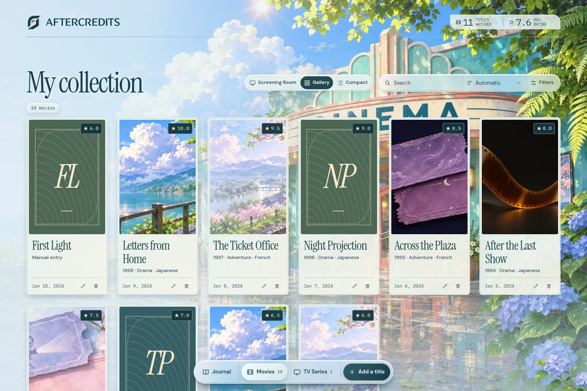

# Collection discovery

Choose **Movies** or **TV Series**, then use the layout switcher beside **My collection**. All three views browse the same saved records. Opening a poster, editing a title and confirming a deletion use the existing journal dialogs.

| View | Browsing behavior |
| --- | --- |
| Screening Room | The default poster stage and horizontal filmstrip. Stage arrows and swipes traverse the entire matching sequence. The filmstrip follows the selected poster across pages of 72. |
| Gallery | Poster grid with personal ratings, release year, genre, language and date added where available. Each page holds up to 24 prints. |
| Compact | A list of up to 60 titles per page. Thumbnail, title and rating stay together on phones. The wider layout gives release year and date added their own columns. |

The page selector jumps directly within large results. Totals in the navigation always describe the archive. The count above the results describes the current section and its matches. Switching layouts retains the search, filters and sort. A search without matches keeps the established latest-title shortcut on the screening stage.

[Screening Room](screening-desktop.webp) · [Gallery on a phone](gallery-phone.webp) · [Compact on desktop](compact-desktop.webp) · [Compact on a phone](compact-phone.webp) · [Filter sheet](filter-sheet.webp)

## Search, filters and order

- **Search** splits a query into words. Every word must occur somewhere in the personal title, stored catalog title or original title. Words may match different title fields. Substrings support partial input and languages that use few spaces. Text is normalized for Unicode width and case, Latin accents and punctuation. Japanese voicing marks are preserved. Matching uses the saved scripts and titles. It does not perform translation or transliteration.
- **Automatic** displays the most recently added entries until a search supplies terms. It then ranks exact title matches first, followed by phrase prefixes, contained phrases and token matches. Word boundaries and the personal display title help break equally strong matches. Choosing an explicit sort keeps it during search.
- **Filters** opens a working copy of the current settings. The match count updates while you select criteria. **Apply** commits the draft. Escape or Close discards it. **Reset filters** clears the draft criteria while retaining its search and sort. Chips remove individual criteria. **Clear all** clears the search and criteria and returns to Automatic order.
- **Genres and languages** use OR within each selector and AND across selectors. For example, Drama plus Adventure with Japanese selected finds Japanese-language titles in either genre. Counts beside options use the entire active Movies or TV Series collection. The preview count reflects the intersection of all active criteria. Genre IDs with no saved name retain their numeric identity.
- **Ranges** include both endpoints and allow an open end. The decade shortcut sets the first and last years of the decade. Ratings use the journal’s 1–10 scale in half steps. The date-added range uses the UTC calendar day of the stored timestamp. A reversed or invalid range disables Apply.
- **Entry source** distinguishes entries with a TMDB ID from manual entries. Missing genre and language have explicit Unknown choices. **Metadata** can show entries missing any tracked detail, a specific detail, the entire snapshot, or entries with complete tracked details. The tracked fields are genre, original language, release date, poster path, backdrop path and description. Artwork flags concern stored paths. They do not probe the image network.
- All records participate in an unrestricted query. A release-year range requires a known release date. Sorting by release keeps unknown dates last in both directions. Explicit order options cover title A–Z/Z–A, highest/lowest rating, earliest/latest release, earliest/latest addition and relevance. Ties use newest addition, an English numeric title comparison, then stable local ID. Relevance with no terms uses date added.
- **Quick sort** offers Highest rated, Recently added and Recent releases. These apply the corresponding sort to the current criteria, with no implicit cutoff or date window.

## Local state and rendering

The query engine consumes the same immutable entry snapshots used by the stage and Data Vault. It indexes normalized titles, date keys, genre IDs and metadata availability in a WeakMap. An edited or replaced entry gets a new index record. The app reuses unchanged records across storage reads and reuses the last result sequence across layout and page changes. Facet counts are built when needed. [Query engine](../../js/discovery.js)

The library renderer retains keyed nodes for the current page. A 1,000-film collection therefore has at most 72 filmstrip cards, 24 gallery cards or 60 compact rows mounted at once, plus up to three stage posters. Artwork uses the existing TMDB path allowlist, lazy loading and the journal’s typographic fallback. Entry animations are bounded and respect reduced motion. [Library renderer](../../js/library.js)

Guest presentation settings use `aftercredits.discovery.v1`. Connected accounts use the existing project and owner namespace for the same preference key. The key holds the layout, section-specific searches, filter and sort choices, and remembered stage IDs. It is separate from the archive, cloud queue, recovery history and backup files. When preference storage is unavailable, controls continue to work for the current tab. [Preferences](../../js/discovery-preferences.js)

Saving an edit, receiving a cloud change, importing a backup or restoring a snapshot refreshes the read model through the existing collection abstraction. Browsing generates no metadata searches, database reads or archive mutations. Displaying an uncached poster may fetch the image from TMDB’s CDN. Background account sync retains its existing lifecycle.

## Deployment and offline upgrades

Deploy the repository root through the existing GitHub Pages workflow. Phase 4A requires no SQL, new credentials, Worker changes or production data migration. The offline shell release is `4a.1`. Its allowlist includes the discovery modules and stylesheet. The browser installs the new bundle before activation. An open 3B tab can finish its work with its existing worker. Close the older tabs and reopen the site to adopt the new release. The service worker cleans up the prior shell cache on activation. Collection data and pending edits live outside that cache. [Offline manifest](../../offline.js)

## Performance against Phase 3B

Both revisions ran on the same machine and local HTTP server setup in headless Chromium 156.0.8078.79 at 1152 × 760. Each metric below is the median of five runs. Each pair used a fresh browser context for each revision, alternating which revision went first. Phase 3B was commit `d9995d5`. [Individual samples](measurements.json)

| Screening Room measurement | Phase 3B | Phase 4A |
| --- | ---: | ---: |
| Empty library ready, cold visit | 347.2 ms | 457.7 ms |
| Empty library ready, warm visit | 52.5 ms | 45.4 ms |
| Sort 300 titles by rating, including layout | 55.0 ms | 24.9 ms |
| Poster navigation, 95th-percentile frame interval per run | 50.0 ms | 16.8 ms |
| Reload a populated 1,000-title library | 125.6 ms | 105.1 ms |
| Search 1,000 titles, returning 100 matches | 30.2 ms | 12.2 ms |
| Filmstrip cards mounted before searching | 1,000 | 72 |
| DOM elements inside the results container before searching | 22,001 | 1,585 |

The library-ready measurement ends when the app first publishes its result count. The search measurement includes input handling, result rendering and a forced layout. The 1,000-title fixture used manual entries and reduced motion to isolate local discovery from image transfer. The navigation benchmark used normal motion. These numbers describe local Chromium runs. They do not measure a physical phone, real poster downloads or production network latency.

Cold startup took 110.5 ms longer in the final paired run. Individual cold visits ranged from 281.3–530.1 ms in 3B and 405.7–553.5 ms in 4A. Warm startup and large-collection interactions improved in the same comparison. To repeat both comparisons, serve the two checkouts on separate local ports and pass both URLs, baseline first, to `python3 tests/motion_perf.py` and `python3 tests/discovery_perf.py`.

## Verification

| Area | Checks |
| --- | --- |
| Query engine and storage contracts | The 32 Node tests include combined and open ranges, UTC boundaries, Unicode and original titles, OR/AND semantics, counts, manual and missing metadata, bidirectional ordering, deterministic ties, replacement of indexed entries and malformed saved preferences. |
| Library interactions | Chromium exercised empty, 10-, 100-, 300- and 1,000-movie collections. Checks included presets, decade selection, removable chips, reset, no results, all layouts, dialogs, editing, deletion, paging, navigating across filmstrip pages by keyboard and reload persistence. |
| Responsive UI and accessibility | Desktop and touch-emulated mobile captures use fresh profiles. Overflow and dialog fit were checked at widths of 320, 360, 390, 430, 768, 1024 and 1440 CSS pixels. The discovery flow ran in reduced-motion mode. The automated axe-core WCAG A/AA check covered the collection and filter dialog. |
| Cloud and Data Vault | The disposable two-device stack used Supabase Auth, PostgREST, PostgreSQL and SMTP. Account and guest choices stayed isolated through sign-in, sign-out and account switching. A synced Vault import appeared in a filtered gallery on another device. A restore removed it, and recovery propagated the archived records. The existing conflict, retry, access-control and offline persistence checks also ran. |
| Offline upgrade | Chromium opened the real 3B frontend, installed its worker, then received the 4A release at the same repository subpath. The new worker waited for the old tab to close. The account reopened offline with its chosen layout and search. Applying a filter and editing a rating offline preserved the original server snapshot and added the expected pending edit. |
| Existing regressions | The guest picker, motion, finish and Vault browser suites cover TMDB fixtures, rating persistence, focus restoration, animation fallbacks, serialized writes, backup export, restore, recovery and storage failures. |

The captures use synthetic records and served artwork from the repository’s original illustrations. The upgrade test uses an isolated account cache. The cloud integration test uses real disposable services. Production account data, production Supabase, live TMDB results, physical phones and other browser engines were outside this verification.

## Reproduce the checks

Run `node --test tests/*.test.mjs`. Serve the project locally, then run `python3 tests/discovery.browser.py <preview-url>` with Python Playwright and Chromium installed. An optional second argument writes captures and `AXE_JS` can identify a local axe-core script. Run the existing picker, motion, finish, Vault and cloud suites as documented in the project and Phase 3B guides. To test an upgrade, pass a separate checkout of Phase 3B at `d9995d5` to `python3 tests/discovery-upgrade.browser.py <baseline-directory>`.
