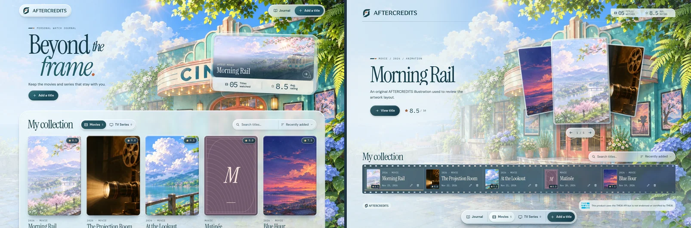
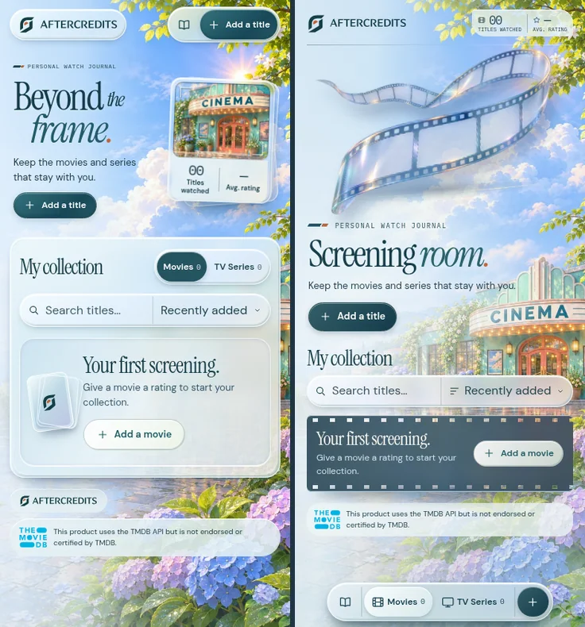

# The screening room

The movie or series you are browsing now occupies the opening scene. Its title and rating face a group of mounted posters above the cinema street. A horizontal strip holds the entire collection, and a floating dock keeps Movies, TV Series and Add a title within reach.

[Watch a five-second Chromium recording of browsing, opening and closing a title](poster-motion.mp4)

## Before and after

Both sides show the same browser size and collection. The previous release is on the left. The new screening room is on the right. Populated screenshots and the recording use isolated test entries and original AFTERCREDITS illustrations in place of external artwork. Real collections use the artwork paths saved with each TMDB entry. First visits start empty.

| Actual browser view | Desktop · 1440 × 960 | Phone · 390 × 844 |
| --- | --- | --- |
| First visit | [Empty stage](desktop-empty.webp) | [Empty stage](phone-empty.webp) |
| Five saved titles | [Stage and filmstrip](desktop-gallery.webp) | [Stage and filmstrip](phone-gallery.webp) |
| Open title | [Backdrop and reading pane](desktop-detail.webp) | [Stacked projection](phone-detail.webp) |
| Find a title | [Catalog results](desktop-picker.webp) | [Catalog results](phone-picker.webp) |
| Rate the selection | [Selected title and score](desktop-picked.webp) | [Selected title and score](phone-picked.webp) |

[Tablet at 768 × 1024](tablet-gallery.webp)

## Composition and interaction

- **Poster stage.** Up to three mounts share one perspective. Angled side prints come forward when selected. The center print opens its details. A first visit shows an original transparent glass-film sculpture. A single entry gets the stage to itself.
- **Filmstrip.** A single tinted strip with transparent sprocket holes anchors the archive. Each frame contains a thumbnail, title, rating, added date and visible edit and remove controls. Search and sort feed the stage and strip together. Cursor keys preview the neighboring title, Enter opens it, and Escape returns focus. On touchscreens a horizontal swipe advances the stage and a tap opens a title.
- **Glass.** Light from the street passes through the dock and search controls. Narrow highlights define the poster edges and follow fine-pointer movement across the stage. The denser filmstrip and reading panes keep small text legible over detailed scenery. Blur belongs to shared surfaces, keeping the cost of the effect independent of collection size.
- **Title projection.** A selected print expands from its visible position as its backdrop fills the viewport. A separate reading pane carries the description, available metadata and personal rating. On phones the pane sits below the poster and can scroll. Missing artwork resolves to title initials. Closing reverses the poster movement.
- **Catalog and rating.** The search surface, rating control and save actions lift above the dock with slightly different timing. The picker keeps the movie or series choice, exact-match results, selected poster, manual entry, and precise half-point slider together. Reduced motion makes the same transitions immediate.

The original cinema street, Splice lockup, self-hosted typefaces and brand introduction remain in use. The changes are confined to the static frontend. The new sculpture is a transparent WebP generated for this environment. The existing archive key, data format, catalog client, Worker URL and deployment configuration are preserved.

## Verification

The seven repository tests passed. The Chromium picker regression test now also covers browsing three saved movies, opening the latest title, arrow-key focus in the filmstrip, filtering down to one poster and preservation of the stored archive while browsing.

Additional browser checks exercised manual and catalog add, edit and delete for both media types, half-point ratings, sort, search, cross-tab updates, full browser restart, offline states, slow detail responses, missing images and long titles. Collection sizes ranged from zero to 300. Touch input distinguished horizontal swipes from taps. Desktop, tablet and phone viewports ranged from 320 to 1440 pixels wide. Automated accessibility checks reported no violations in the four tested states. Reduced-motion mode was checked both on load and during a transition.

The catalog integration ran against the Worker with controlled upstream responses. The cloud network rejected outbound connections to the deployed Worker and image CDN during this pass, so fresh production searches and official image delivery could not be confirmed here. Screenshots, recordings and touch checks were made in Chromium. Physical-device Safari was outside this verification.
